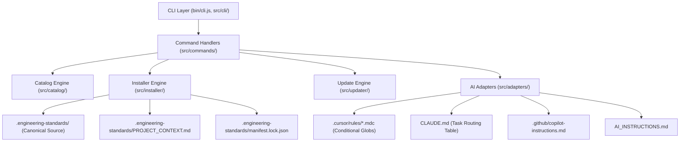
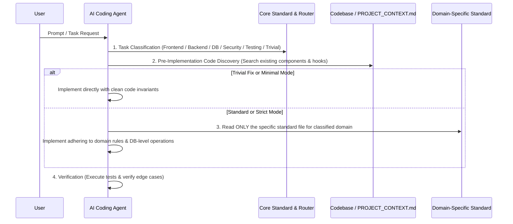

# Architecture Specification — Engineering Standards

## 1. System Overview
`engineering-standards` is structured as a layered, modular CLI toolkit, prompt management system, and token-optimized AI context router. It acts as the bridge between human-authored architectural standards, project-specific developer configurations, and downstream AI coding assistants.

---

## 2. Token Efficiency & Progressive Context Loading Architecture

Instead of dumping every engineering standard file into the AI's prompt for every query, the system uses a **Progressive Context Architecture**:

### A. Hierarchical Instruction Tiers
- **Tier 1 — Core & Routing (Always Loaded)**: High-level architectural rules, clean code naming, error handling, mode definitions, and the task classification routing table.
- **Tier 2 — Living Project Context (`PROJECT_CONTEXT.md`)**: Project-specific living registers documenting tech stack, directory layouts, existing reusable components, custom hooks, and API clients.
- **Tier 3 — Domain Engineering Standards (Loaded On-Demand)**: Deep engineering rules (e.g. database-level operations, keyset pagination, component prop typing) loaded **only** when the task affects that specific domain.
- **Tier 4 — Framework Profiles (Loaded On-Demand)**: Specialized framework instructions (Next.js App Router, Prisma ORM, FastAPI) loaded only when working with that technology.

---

## 3. Layer Responsibilities

### A. CLI & Argument Handling (`src/cli/`, `src/commands/`)
- Pure user interaction, terminal formatting, argument validation, and invocation orchestration.
- Uses `commander` for explicit declarative routing and flags.
- Uses `picocolors` for zero-overhead, clean terminal styling.
- Zero business logic in commands: commands delegate directly to catalog, installer, or update engines.

### B. Catalog Engine (`src/catalog/`)
- Single source of truth: `catalog/prompts.json`.
- Validates prompt records at runtime using `zod`.
- Resolves dependencies and detects circular dependency graphs using topological sort.
- Validates that every file declared in the catalog actually exists on disk.
- Enforces path safety: prevents directory traversal attacks outside the prompts root.

### C. Canonical Storage, Manifest & Project Context (`.engineering-standards/`)
- The installed directory `.engineering-standards/` is the canonical, developer-owned single source of truth.
- `PROJECT_CONTEXT.md` maintains living project registers.
- `config.json` stores user preferences, instruction loading mode (`minimal`, `standard`, `strict`), selected categories, profiles, and AI tool integrations.
- `manifest.lock.json` stores installed files, versions, and SHA-256 hashes for 3-way update tracking.

### D. AI Tool Adapters (`src/adapters/`)
- Adapters generate progressive routing instructions tailored to each target tool:
  - **Cursor**: Rule files in `.cursor/rules/*.mdc`. `core.mdc` is `alwaysApply: true`. Domain rules are `alwaysApply: false` with targeted file `globs` so Cursor loads them only when matching files are active.
  - **Claude Code**: Compact Task Routing Table in `CLAUDE.md`, delegating cleanly to canonical prompts.
  - **GitHub Copilot**: `.github/copilot-instructions.md` with progressive loading routing.
  - **Generic**: Portable `AI_INSTRUCTIONS.md`.

### E. Safe Update Engine (`src/updater/`)
- Performs true three-way diffing:
  1. Base (upstream snapshot at install time)
  2. Local (developer's modified file)
  3. Upstream (new version in updated package)
- Automatically merges non-conflicting edits.
- Alerts user to conflicts, generates backup snapshots before updating, and supports rollback.

### F. Security & Path Traversal Guarantees
- All path manipulations use strict normalization and containment checks (`isPathInside`).
- Rejects any prompt identifier or catalog entry referencing paths outside the package or target project boundary.
- Zero arbitrary script execution. Zero telemetry.
